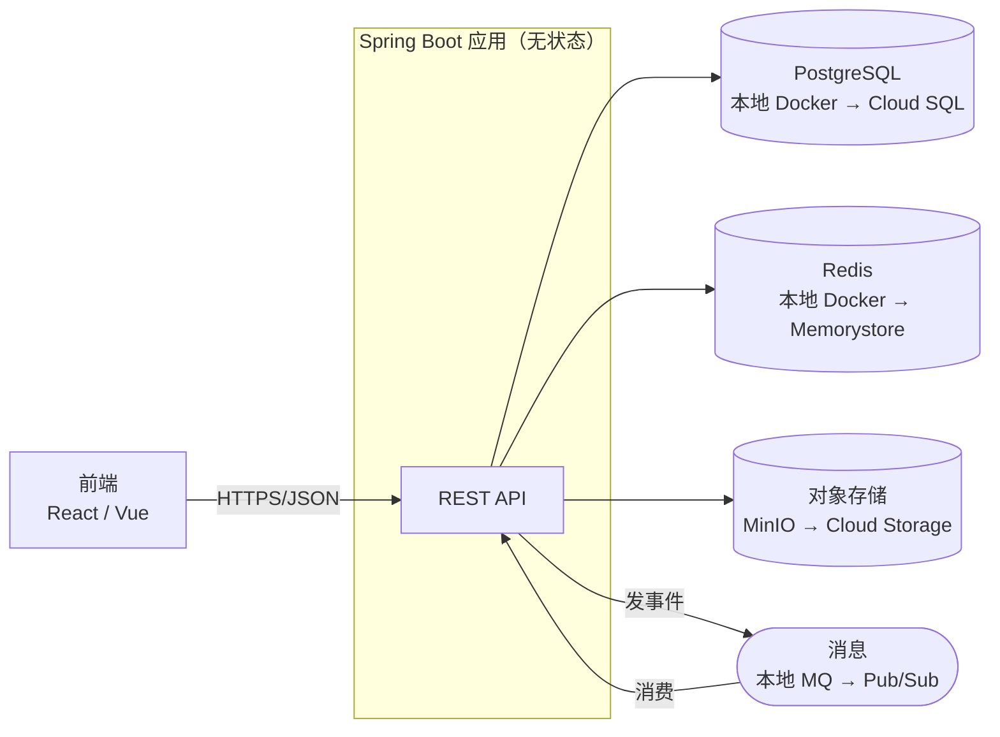
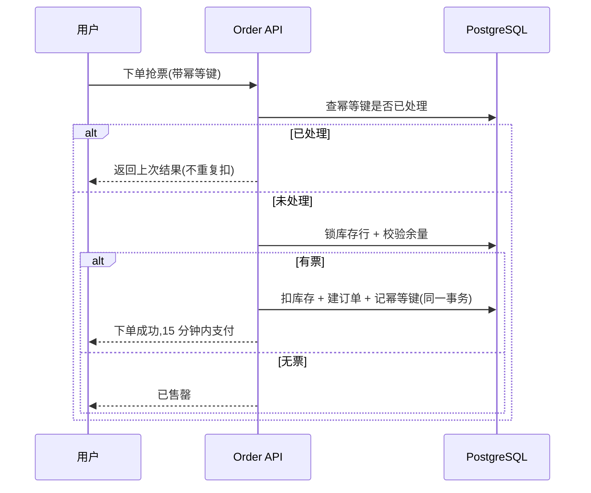

# 架构设计

本文档记录项目的整体设计思路,是边学边建的"地图"。随阶段推进会更新。

## 1. 场景与范围

一个让**主办方发布活动**、**用户抢票下单**的平台。范围刻意框小,只保留能撑起技术练习的部分。

核心实体:

| 实体 | 说明 |
|------|------|
| User | 买家 / 主办方(organizer),两种角色 |
| Event | 活动(标题、时间、场地、海报图、状态) |
| TicketType | 票档(普通 / VIP,价格,**库存**) |
| Order | 订单 |
| Reservation | 占座记录(带**过期时间**) |
| Payment | 支付(先 mock,不接真实支付) |

## 2. 核心流程 → 练什么 → GCP 服务

每条流程都是刻意设计的,对应一块必学技能:

| 流程 | 练什么(Java) | 落到哪个 GCP |
|------|--------------|-------------|
| 主办方建活动 + 传海报 | JPA 建模、文件上传抽象 | Cloud Storage |
| 用户浏览活动列表 | 分页、热门缓存 | Memorystore(Redis) |
| **用户抢票下单** | **事务 + 并发锁 + 幂等 + 库存扣减** | Cloud SQL |
| 占座 15 分钟超时释放 | 定时任务、状态机 | Cloud Scheduler |
| 支付回调出票 | 回调幂等、状态流转 | Cloud SQL |
| 出票后发通知 | 异步消息、事件驱动 | Pub/Sub |
| 登录鉴权 | Spring Security + JWT | Secret Manager |

**抢票是技术重头戏**:同一用户狂点下单不能重复扣款,两个用户抢最后一张票不能超卖。乐观锁 vs 悲观锁、幂等键设计都在这。

## 3. 架构:模块化单体

先用**模块化单体(Modular Monolith)**,不要一上来微服务。体量够用、事务好做、调试简单。等某个模块真扛不住再按边界拆(`order` 或 `ticket` 是第一候选)。

```
com.example.ticketing
├── common/         幂等、全局异常、统一响应、配置
├── auth/           注册登录、JWT、角色
├── event/          活动 CRUD、海报上传
├── ticket/         票档、库存管理（并发核心）
├── order/          下单、占座、超时释放
├── payment/        支付 mock、回调出票
└── notification/   Pub/Sub 异步通知
```

### 分层(每个模块内部,DDD 风格)

- **接入层 Interface**:Controller、DTO、参数校验、鉴权
- **应用层 Application**:用例编排、事务边界
- **领域层 Domain**:纯业务模型与规则,不依赖框架/DB
- **基础设施层 Infrastructure**:JPA 仓储、Redis、消息、外部调用

原则:依赖只能从外向内(接入 → 应用 → 领域),领域层最干净。

## 4. 云原生设计原则(从第一天就遵守)

能否顺滑上 GCP,只取决于一件事:**应用进程自己不存状态,状态全外置**。详见 [GCP.md](GCP.md)。

1. **无状态**:不在内存存 session,用 JWT 或 Redis
2. **配置外置**:Spring profiles(`dev`/`prod`),不硬编码
3. **容器化**:Dockerfile 从第一天就有
4. **外部依赖走抽象**:存文件用 Spring 的 `Resource`,不直接 `new File()`
5. **结构化日志**:打到 stdout,云上自动采集
6. **健康检查**:Actuator 暴露 `/actuator/health`

## 5. 架构图

### 部署拓扑(本地 ↔ GCP)



### 抢票时序(阶段 2 的核心)



## 6. 分阶段路线图

| 阶段 | 目标 | 新学的东西 |
|------|------|-----------|
| **0** 脚手架 | 应用能起、能打包成镜像、本地依赖拉起 | Spring Boot、Docker、Compose、Flyway |
| **1** 基础域 | 活动 CRUD + 用户认证跑通 | JPA 实体/仓储、三层划分、Spring Security |
| **2** 抢票核心 | 下单不超卖、不重复 | 事务、乐观/悲观锁、幂等 |
| **3** 占座 + 海报 | 超时自动释放、海报上传 | 定时任务、状态机、文件存储抽象 |
| **4** 异步 + 缓存 | 出票发通知、热门活动缓存 | 消息队列、Redis 缓存策略 |
| **5** 上云 | 部署到 GCP、CI/CD | Cloud Run、Cloud SQL、Artifact Registry、GitHub Actions |
| **6** 可观测 | 结构化日志、监控、集成测试 | Actuator、Testcontainers、Cloud Logging |

## 7. 几块硬骨头(本项目的学习价值所在)

普通 CRUD 碰不到、但真实系统和面试天天问:

- **幂等性**:同一笔下单请求重发,不能扣两次。靠"业务流水号唯一键 + 幂等表"
- **并发一致性**:两笔下单同抢一个票档,库存不能错。乐观锁(version)vs 悲观锁(`SELECT FOR UPDATE`)取舍
- **一致性边界**:扣库存、建订单、记幂等必须同一个本地事务,要么全成要么全败
- **超时释放**:占座 15 分钟不付就释放库存——定时任务 + 状态机
- **审计不可篡改**:订单/支付流水只追加不改
